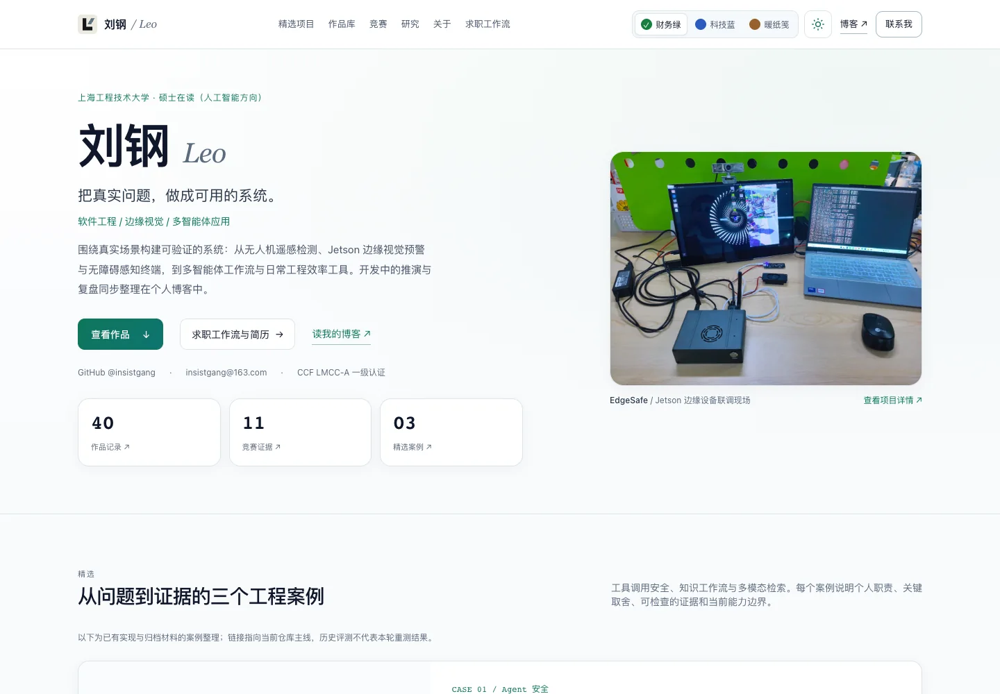

<!-- README_SYNC: source=working-tree; updated=2026-11-15 -->

<p align="center">简体中文 · <a href="./README_EN.md">English</a></p>

# Leo's Portfolio · 刘钢个人作品集系统

刘钢（Leo）的公开软件工程与研究作品集：以静态站点呈现 **40 条项目与经历记录、11 项证书展示**，并提供可复现的构建、预览生成与内容检查。

如果这个静态作品集的实现对你有参考价值，欢迎 [Star 仓库](https://github.com/insistgang/portfolio)，方便收藏，也让有同类需求的人更容易发现它。

[](https://github.com/insistgang/portfolio)
[](https://insistgang.top/portfolio/)
[](https://nodejs.org/)
[](https://github.com/insistgang/portfolio/commits/main)
[](https://github.com/insistgang/portfolio/issues)

<p align="center">
  <a href="https://insistgang.top/portfolio/">在线作品集</a> ·
  <a href="https://insistgang.top/portfolio/career/">求职工作流</a> ·
  <a href="https://insistgang.top/portfolio/yds/">视频数据大屏</a> ·
  <a href="#快速开始">本地运行</a>
</p>



> 截图来自当前工作区的本地页面，采集于 2026-11-15。它展示作品集界面与已收录内容，不代表外部项目的后端或真机已重新验收。

## 这是什么

一个以 **HTML、CSS、原生 JavaScript** 实现的静态作品集系统，不需要后端服务即可浏览。Tailwind CSS 在构建期编译，Lucide 图标随仓库本地提供；页面运行时不请求第三方脚本、字体或图片 CDN。

适合用于展示软件项目、研究工作和竞赛证据，也适合作为“内容、原始素材、轻量预览、生成脚本、检查规则”分层维护的参考。

### 核心差异

- **原件与轻量展示分开**：证书和项目原图用于详情、高清链接与 PDF；卡片和静态展示使用 30 张 WebP 预览，不用压缩副本替换证据原件。
- **三套风格与明暗切换**：财务绿、科技蓝、暖纸笺，支持太阳／月亮一键切换；未手动选择时跟随系统。风格与明暗偏好分别保存在当前浏览器，存储被禁用时当前页面仍可切换。
- **内容有来源，示意图有边界**：截图、证书、工程示意图分别标注；示意图明确“非界面截图”，不冒充交付证据。财务项目只介绍工程实现，不读取或展示账务数据。
- **无脚本也能读证书**：静态证书墙保留完整排序。启用 JavaScript 后，可搜索、筛选、打开多图详情、键盘切换项目，并处理焦点与滚动导航。
- **检查不只核对页面是否存在**：覆盖项目计数、图片对应关系、主题状态、生成器输入、PDF 防覆盖，以及 604 条事件的分类、分页与汇总复算。

## 页面与内容

| 入口 | 当前工作区内容 |
| --- | --- |
| [`index.html`](./index.html) | 3 个精选工程案例、40 条可检索记录、11 项证书展示、研究和技术栈 |
| [`career/index.html`](./career/index.html) | 教育、核心能力、15 项核心项目、实习、竞赛、29 条投递记录及中英文审阅版简历入口 |
| [`yds/index.html`](./yds/index.html) | 8 段本地测试视频、5,494 帧检测、604 条结构化事件的可筛选离线复核大屏 |

40 条是**展示记录**，不是独立项目数；同一工程可因产品、竞赛或研究证据分别收录。

| 分类 | 数量 | 说明 |
| --- | ---: | --- |
| 软件与工具 `products` | 22 | AI 工作流、个人工具、边缘应用、财务工程介绍等 |
| 竞赛记录 `competition` | 11 | 证书图、奖项层级、奖次、年份与对应项目说明 |
| 研究工作 `research` | 3 | 多尺度图像检测、轻量变化检测、计算传播合作 |
| 产业实践 `industry` | 4 | 后端与 AI 应用、图像检测交付、机器人协作、电商数据链路 |

竞赛按全国奖优先，再按奖次、年份排列；同档同年保留原顺序。该顺序是展示优先级，不是官方含金量排名。2026 年 LinkCity 与 2025 年智慧城市项目分别记录。

## 快速开始

### 环境要求

| 工具 | 用途 |
| --- | --- |
| Node.js `>= 18` 与 npm | 安装锁定依赖、编译 CSS、运行检查 |
| Python 3.9+ | 生成器检查与本地静态预览 |
| Ruby | YAML 解析；`npm run check` 的真实 CLI 测试也需要 |
| Pillow（可选） | 生成和校验 WebP 预览 |
| ReportLab 与 macOS 系统字体（可选） | 生成作品集 PDF |

在仓库根目录执行：

```bash
git clone https://github.com/insistgang/portfolio.git
cd portfolio
npm ci
npm run build
npm run check
python3 -m http.server 8000
```

打开 http://localhost:8000/ 即可浏览主站；求职页为 http://localhost:8000/career/ ，视频大屏为 http://localhost:8000/yds/ 。

> 本 README 描述**当前工作区**。本地修改不等于已经发布；线上版本与发布验收记录见 [`ROADMAP.md`](./ROADMAP.md)。

## 构建与维护结构

```text
styles/input.css → Tailwind CSS → assets/site.css
node_modules/lucide → scripts/vendor.mjs → assets/vendor/lucide.min.js
assets/theme.js + assets/theme.css + assets/career.css → 三页共享外观
原始图片 → scripts/build_previews.py → assets/images/previews/ + sources.json
index.html + 本地资源 → 浏览器静态展示
scripts/check.mjs + scripts/check-theme.mjs + scripts/check_career_cli.py → 检查门禁
```

主要目录：

- `index.html`：静态精选、证书墙、项目数据与主站交互。
- `assets/`：主题、编译后的样式、本地图标、原始图片、预览和公开文档。
- `career/`、`yds/`：共享主题的两个独立子页面。
- `scripts/`：预览生成、求职页生成、PDF 生成与检查脚本。
- `CONTENT_NOTES.md`：内容依据、历史校准和素材边界。
- `ROADMAP.md`：当前进度、验证记录、发布状态与待审事项。

### 图片与证据约定

项目数据中的 `image` 始终指向原件，`preview` 只用于卡片。重新生成预览不会覆盖原始图片；`assets/images/previews/sources.json` 保存原图 SHA-256 与对应关系。

```bash
python3 scripts/build_previews.py
python3 scripts/build_previews.py --check
npm audit
```

本地实测中，在同一干净浏览器、禁用缓存并加载全部展示图片的条件下，图片传输从 17,752,285 字节降为 2,688,746 字节，减少 84.9%。这是特定版本的资源量对照，不是弱网加载速度或普遍性能承诺；详细验证范围见 `ROADMAP.md`。

### 检查命令

| 命令 | 覆盖范围 |
| --- | --- |
| `npm run build` | 编译 Tailwind CSS 并同步本地 Lucide 脚本 |
| `npm run check` | 项目与证书对应、资源路径、主题状态、生成器、45 种事件筛选组合及汇总复算 |
| `python3 scripts/build_previews.py --check` | 30 张预览的解码、尺寸、原图摘要和体积关系 |
| `npm audit` | npm 依赖漏洞审计 |
| `git diff --check` | 差异中的空白错误 |

`npm run check` 不自动安装 Python 可选依赖，也不替代浏览器、外部项目后端、真机或 PDF 的视觉验收。

## 生成公开内容

### 求职页

```bash
python3 scripts/build_career_page.py \
  --profile-dir "/path/to/Career-Copilot/data/master_profile" \
  --applications "/path/to/Career-Copilot/data/applications.json" \
  --resume "中文简历:assets/career/resume_zh_reviewed.pdf" \
  --resume "English Resume:assets/career/resume_en_reviewed.pdf" \
  --out career/index.html
```

- 经历主库与投递数据是**外部输入，不随本仓库提供**；生成器不改写它们。
- 竞赛记录读取主站数据，避免旧经历主库覆盖已核对的证书与排序。
- 外部链接仅允许 HTTP(S)。简历仅允许 `assets/career/` 下已审阅的中英文 PDF，输出目录旁必须存在对应文件。
- 不接受私人目录中的绝对路径，也不自动复制私人文件为公开资源。

### 作品集 PDF

```bash
python3 scripts/build_portfolio_pdf.py --output .tmp/portfolio-review/portfolio-$(date +%Y%m%d-%H%M%S).pdf
```

统计与完整奖项从主站数据读取。输出 PDF 和同名布局检查 JSON 都必须是新文件，不能覆盖既有版本。发布前应逐页检查 20 页排版；网页的三套主题不用于 PDF 排版。

## 隐私、兼容性与当前限制

- 公开展示的真实经历、证书和投递快照，不代表其中外部项目已经重新部署或复测。
- 财务入口需要身份验证；作品集不连接其数据接口，也不公开私有仓库或账务记录。
- 键盘、焦点、主题与响应式检查有本地验收记录，但不等于所有浏览器或辅助技术的兼容性认证。
- Tailwind 3.4.17 CLI 的内置浏览器数据仍可能提示过期；当前不通过屏蔽警告处理。大版本升级和其余待审事项见 `ROADMAP.md`。
- 历史素材、旧简历和输出文件不能仅凭“未引用”就删除，保留与清理决策单独审查。

## 贡献与支持

欢迎通过 [Issues](https://github.com/insistgang/portfolio/issues) 报告内容错误、资源失效或交互问题；代码修改可通过 [Pull Requests](https://github.com/insistgang/portfolio/pulls) 提交。提交前请运行 `npm run build` 和 `npm run check`，补充新素材的来源，不加入私人数据或未授权凭据。

## 许可证与致谢

仓库根目录目前没有统一的 `LICENSE` 文件。**公开可访问不等于授予复制、修改或再分发许可**；需要复用项目代码或内容时，请先与作者确认授权范围。

第三方依赖保留各自声明：

- [Lucide 许可说明](./assets/vendor/lucide-LICENSE)：ISC，含 Feather / MIT 权属说明。
- [Tailwind CSS 许可说明](./assets/vendor/tailwindcss-LICENSE)：MIT。

截图、证书、第三方素材及外部项目内容仍按各自来源和授权范围处理，不由本仓库统一重新授权。

如果这个项目的结构和验证方式对你有帮助，可以点一个 Star 方便以后回来；有问题或改进建议，也欢迎直接提 Issue。
