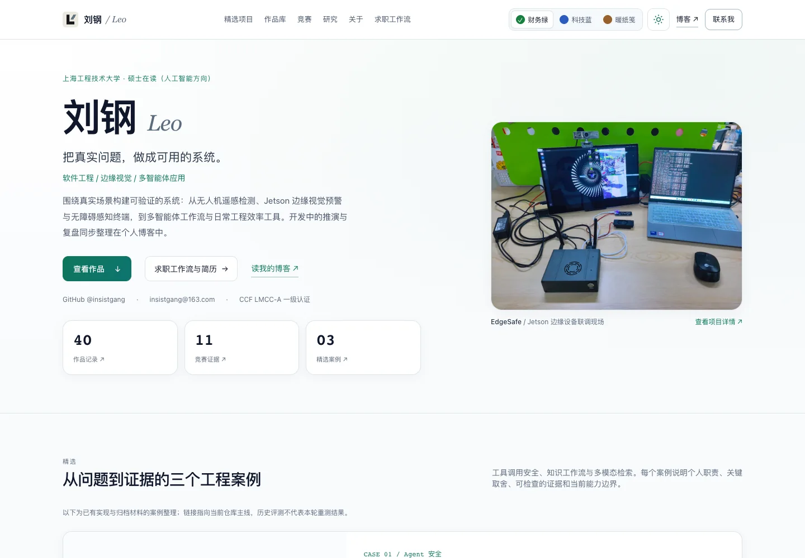

<!-- README_SYNC: source=working-tree; updated=2026-11-15 -->

<p align="center"><a href="./README.md">简体中文</a> · English</p>

# Leo's Portfolio · Software Engineering & Research

A static software engineering and research portfolio for Liu Gang (Leo), presenting **40 project and experience records and 11 certificate entries**, with reproducible build, preview generation, and content checks.

If this approach to building a static portfolio is useful to you, [star the repository](https://github.com/insistgang/portfolio) to bookmark it and help other developers discover it.

[](https://github.com/insistgang/portfolio)
[](https://insistgang.top/portfolio/)
[](https://nodejs.org/)
[](https://github.com/insistgang/portfolio/commits/main)
[](https://github.com/insistgang/portfolio/issues)

<p align="center">
  <a href="https://insistgang.top/portfolio/">Live portfolio</a> ·
  <a href="https://insistgang.top/portfolio/career/">Career workflow</a> ·
  <a href="https://insistgang.top/portfolio/yds/">Video telemetry</a> ·
  <a href="#quick-start">Run locally</a>
</p>



> Captured from the local working-tree page on 2026-11-15. This image demonstrates the portfolio UI and its curated content; it is not a new backend or hardware validation of the linked projects.

## What it is

A static portfolio built with **HTML, CSS, and vanilla JavaScript**. No backend is required to browse it. Tailwind CSS is compiled at build time, and Lucide icons are served locally. Pages do not request third-party script, font, or image CDNs at runtime.

It is designed for presenting software projects, research, and competition evidence, with separate layers for content, original assets, lightweight previews, generation scripts, and validation rules.

### What makes it different

- **Original evidence stays intact**: Original certificates and project images are used in detail views, full-resolution links, and PDF generation. Cards and static sections use 30 WebP previews instead of replacing originals with compressed copies.
- **Three visual styles, two color modes**: Finance green, technology blue, and warm paper, with one-click sun/moon switching. System preferences apply until the visitor makes a choice. Style and color-mode preferences are stored independently; switching still works in memory when browser storage is unavailable.
- **Source and illustration boundaries are explicit**: Screenshots, certificates, and engineering illustrations are labeled differently. Illustrations are marked as non-screenshots and are not presented as delivery evidence. The finance entry describes engineering only; it does not read or expose accounting data.
- **Certificates work without JavaScript**: The static award wall retains its full order. JavaScript adds search, filters, multi-image dialogs, keyboard navigation, focus management, and viewport-aware section highlighting.
- **Checks go beyond page existence**: Validation covers record counts, image relationships, theme state, generator inputs, PDF overwrite protection, and the classification, pagination, and independent aggregation of 604 events.

## Pages and content

| Entry | Current working-tree content |
| --- | --- |
| [`index.html`](./index.html) | Three featured case studies, 40 searchable records, 11 certificate entries, research, and technical skills |
| [`career/index.html`](./career/index.html) | Education, core skills, 15 core projects, internships, awards, 29 application records, and reviewed Chinese/English resume links |
| [`yds/index.html`](./yds/index.html) | An offline review dashboard for 8 local test videos, 5,494 analyzed frames, and 604 structured events |

The 40 entries are **presentation records, not distinct projects**. One system may appear in product, competition, or research contexts when the supporting evidence differs.

| Category | Count | Scope |
| --- | ---: | --- |
| Software and tools `products` | 22 | AI workflows, personal tools, edge applications, and finance engineering |
| Competition records `competition` | 11 | Certificate images, award level, prize, year, and project context |
| Research `research` | 3 | Multi-scale image detection, lightweight change detection, and computational communication |
| Industry practice `industry` | 4 | Backend and AI applications, vision delivery, robotics collaboration, and commerce data pipelines |

National awards appear first, followed by prize tier and year; original order is retained within the same tier and year. This is a presentation rule, not an official ranking of award value. The 2026 LinkCity entry and the 2025 smart-city entry remain separate.

## Quick start

### Requirements

| Tool | Purpose |
| --- | --- |
| Node.js `>= 18` and npm | Install locked dependencies, compile CSS, and run checks |
| Python 3.9+ | Generator checks and the local static server |
| Ruby | YAML parsing, including the real CLI fixture exercised by `npm run check` |
| Pillow (optional) | Generate and validate WebP previews |
| ReportLab and macOS system fonts (optional) | Generate the portfolio PDF |

From the repository root:

```bash
git clone https://github.com/insistgang/portfolio.git
cd portfolio
npm ci
npm run build
npm run check
python3 -m http.server 8000
```

Open http://localhost:8000/ for the main portfolio. The career page is at http://localhost:8000/career/ and the telemetry dashboard at http://localhost:8000/yds/ .

> This README describes the **current working tree**. Local edits are not necessarily deployed. See [`ROADMAP.md`](./ROADMAP.md) for the published version and its verification history.

## Build and maintenance structure

```text
styles/input.css → Tailwind CSS → assets/site.css
node_modules/lucide → scripts/vendor.mjs → assets/vendor/lucide.min.js
assets/theme.js + assets/theme.css + assets/career.css → shared appearance across three pages
original images → scripts/build_previews.py → assets/images/previews/ + sources.json
index.html + local assets → static browser presentation
scripts/check.mjs + scripts/check-theme.mjs + scripts/check_career_cli.py → validation gates
```

Key locations:

- `index.html`: Featured cases, the certificate wall, project data, and main-page interactions.
- `assets/`: Themes, compiled CSS, local icons, original images, previews, and public documents.
- `career/`, `yds/`: Independent subpages sharing the same theme system.
- `scripts/`: Preview generation, career-page generation, PDF generation, and checks.
- `CONTENT_NOTES.md`: Content evidence, historical corrections, and asset boundaries.
- `ROADMAP.md`: Current progress, validation records, deployment status, and review items.

### Images and evidence

The `image` field always points to the original asset; `preview` is used only for cards. Regenerating previews never overwrites originals. `assets/images/previews/sources.json` records the original SHA-256 and its preview relationship.

```bash
python3 scripts/build_previews.py
python3 scripts/build_previews.py --check
npm audit
```

In a local comparison using the same clean browser, disabled cache, and all display images loaded, image transfer fell from 17,752,285 bytes to 2,688,746 bytes, an 84.9% reduction. This is a resource-size comparison for one version, not a universal loading-speed or performance claim. See `ROADMAP.md` for the measurement scope.

### Checks

| Command | Coverage |
| --- | --- |
| `npm run build` | Compile Tailwind CSS and synchronize the local Lucide script |
| `npm run check` | Project/certificate consistency, resource paths, theme state, generators, all 45 event-filter combinations, and independent aggregation |
| `python3 scripts/build_previews.py --check` | Decode 30 previews and validate dimensions, original hashes, and size relationships |
| `npm audit` | Audit npm dependencies for known vulnerabilities |
| `git diff --check` | Detect whitespace errors in the diff |

`npm run check` does not install optional Python packages and is not a substitute for browser, external-backend, hardware, or visual PDF validation.

## Generating public content

### Career page

```bash
python3 scripts/build_career_page.py \
  --profile-dir "/path/to/Career-Copilot/data/master_profile" \
  --applications "/path/to/Career-Copilot/data/applications.json" \
  --resume "中文简历:assets/career/resume_zh_reviewed.pdf" \
  --resume "English Resume:assets/career/resume_en_reviewed.pdf" \
  --out career/index.html
```

- The master profile and application records are **external inputs and are not bundled with this repository**. The generator does not rewrite them.
- Competition entries are read from the main portfolio so an older profile cannot override reviewed certificate data or ordering.
- External links are restricted to HTTP(S). Only the reviewed Chinese and English PDFs under `assets/career/` are accepted, and the corresponding files must exist beside the output directory.
- Absolute paths to private files are rejected. The generator never copies a private resume into the public site automatically.

### Portfolio PDF

```bash
python3 scripts/build_portfolio_pdf.py --output .tmp/portfolio-review/portfolio-$(date +%Y%m%d-%H%M%S).pdf
```

Counts and the complete award list come from the main project data. Both the PDF and its companion layout-check JSON must be new paths; existing files are never overwritten. Review all 20 pages visually before publication. The website's three visual styles are not applied to PDF output.

## Privacy, compatibility, and current limits

- Public experience, certificates, and application snapshots do not imply that the linked external projects have been redeployed or retested.
- The finance dashboard requires authentication. The portfolio does not call its data API or expose its private repository or accounting records.
- Keyboard, focus, theme, and responsive behavior have local verification records, not a compatibility certification for every browser or assistive technology.
- Tailwind 3.4.17's bundled browser data may still emit an outdated-data warning. The warning is not hidden. A major-version migration and other review items are tracked in `ROADMAP.md`.
- Historical assets, old resumes, and output files are not deleted merely because they are unreferenced. Retention and cleanup are reviewed separately.

## Contributing and support

Use [Issues](https://github.com/insistgang/portfolio/issues) to report incorrect content, broken assets, or interaction problems. Code changes are welcome through [Pull Requests](https://github.com/insistgang/portfolio/pulls). Before submitting, run `npm run build` and `npm run check`, document the source of any new asset, and exclude private data and unauthorized credentials.

## License and acknowledgements

There is currently no repository-wide `LICENSE` file at the root. **Public visibility does not by itself grant permission to copy, modify, or redistribute the work.** Contact the author to confirm the permitted scope before reusing project code or content.

Third-party dependency notices are preserved:

- [Lucide license](./assets/vendor/lucide-LICENSE): ISC, including Feather / MIT attribution.
- [Tailwind CSS license](./assets/vendor/tailwindcss-LICENSE): MIT.

Screenshots, certificates, third-party assets, and external project content remain subject to their respective sources and permissions; this repository does not relicense them as a single work.

If the project structure and validation approach are useful to you, a Star makes it easier to find again. Questions and improvement suggestions are welcome in the issue tracker.
